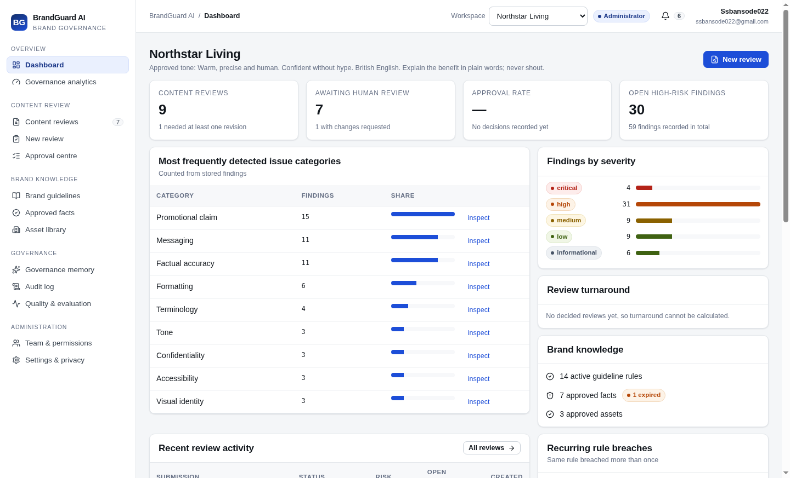
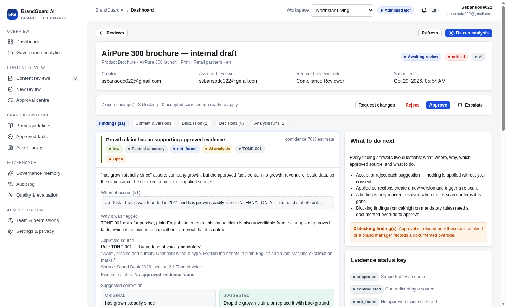

# BrandGuard AI

**Intelligent brand governance and compliance platform** — define your approved brand rules
and facts, submit content for review, get evidence-linked findings with suggested
corrections, run a human-controlled approval workflow, and see which problems keep coming
back. Built for the Inkloom AI hackathon problem statement on intelligent brand governance.

**Live application:** https://brandguard.apps.lemma.work

---

## 📌 Table of Contents

* [About](#-about)
* [Features](#-features)
* [Tech Stack](#️-tech-stack)
* [Project Structure](#-project-structure)
* [Installation](#️-installation)
* [Usage](#-usage)
* [Screenshots](#-screenshots)
* [Testing](#-testing)
* [New in this release](#-new-in-this-release)
* [Round 5: accuracy, multi-format creatives, governed publishing](#-round-5-accuracy-multi-format-creatives-governed-publishing)
* [Privacy & Security](#-privacy--security)
* [Known Limitations](#️-known-limitations)
* [Documentation](#-documentation)
* [Contributing](#-contributing)
* [License](#-license)
* [Contact](#-contact)

---

## 📖 About

BrandGuard AI is a working brand-governance platform, not a mock-up. It lets an
organisation define its brand policy once — guideline rules with enforcement levels,
approved facts and claims with evidence, approved visual assets, and a governance policy —
and then checks every piece of content against **only those approved sources** before it is
published. Every screen is backed by a real database, every analysis is a real pipeline run
against real records, and every number on the analytics pages is counted from stored data.

I built it because the failure mode in brand governance is not "nobody spotted the mistake".
It is that mistakes are spotted late, inconsistently, and without a trail: a deprecated
product name slips into a campaign, a price contradicts the specification, a warranty claim
is off by two years, a superlative has no evidence behind it, internal-only material ends up
in a partner brochure, and nobody can tell whether that was a one-off or the fifth time this
quarter. Manual review cannot keep up, and a plain LLM checker makes it worse — it produces
confident explanations with invented citations, and it is happy to "approve" content on its
own.

BrandGuard AI solves that with one design principle: **every important finding must answer
five questions** — what is the problem, where does it occur, why was it flagged, which
approved source supports it, and what should the reviewer do next. Where the evidence is not
sufficient, the platform says so explicitly ("no approved evidence found", "source expired",
"ambiguous — needs human judgement") instead of guessing. The AI assists a person; it never
approves, and it never publishes.

It is built for the people who actually do this work: **brand managers** who own the rules
and the assets, **content creators** who submit work and apply corrections, **reviewers**
who inspect findings and decide, **compliance reviewers** who sign off sensitive claims, and
**administrators** who own the workspace, the roles, the policy and the audit trail.

---

## ✨ Features

* **Guideline rule library with enforcement levels:** every rule has a category (tone,
  terminology, messaging, factual accuracy, promotional claims, visual identity,
  accessibility, confidentiality, legal, formatting), a rule type, a severity and one of
  three enforcement levels — mandatory, recommended or advisory. Only rules that a person
  has approved are enforced; drafts and AI proposals are never authoritative.
* **Rule import from a brand document:** upload a brand book or policy PDF/DOCX, the
  platform converts it to text, proposes candidate rules with the exact source quote, and
  saves them as drafts for a human to review and approve.
* **Approved facts and claims library:** product specifications, prices, warranty terms,
  discounts, availability, certifications, company facts and approved statements — each with
  its exact substantiated scope, effective and expiration dates, an owner, evidence records
  and six verification states (verified, expired, pending, rejected, superseded, no
  evidence). Expired records are never treated as current truth.
* **Approved asset library:** logos, logo variants, campaign images and templates with
  version history, approval status, usage restrictions, dominant colours and a perceptual
  hash — so the visual check can compare a submitted image against what is actually approved.
* **Deterministic compliance engine:** exact terminology matching (prohibited, deprecated,
  required), mandatory disclaimers gated by relevance, unit-aware numeric comparison against
  approved facts, expired-fact detection, promotional-claim evidence checks, confidentiality
  markers, formatting heuristics, and HTML accessibility checks.
* **Evidence-grounded AI analysis:** a pod agent reviews tone, messaging and
  context-dependent claims against only the supplied approved rules and facts, and returns
  schema-validated findings. Output is validated on the backend — unknown rule codes or fact
  ids are dropped, quoted text is verified against the content, and a malformed reply is
  retried once and then reported honestly rather than shown as a clean result.
* **Evidence-linked findings:** each finding carries severity, an estimated confidence,
  an evidence status (supported / contradicted / not found / expired / ambiguous / stylistic
  / unverified), the exact quoted span, the approved rule or fact it was checked against with
  its source location, an explanation, and a suggested correction with a rationale.
* **AI correction assistant:** accept, reject, edit, regenerate with your own instructions,
  or restore the original wording — displayed side by side with the original. Nothing is
  applied without consent, and the assistant never invents product facts.
* **Correction validation:** applying corrections creates a new content version, invalidates
  the previous analysis, and re-runs the checks. A finding is only marked resolved when the
  re-scan confirms the problem is gone; re-detected findings are reopened, and new issues
  introduced by the fix are caught.
* **Human-controlled, risk-based approval workflow:** a server-side state machine (draft →
  submitted → analysing → awaiting review → changes requested → resubmitted →
  approved/rejected/archived, with analysis-failed as a first-class state). Critical claims
  route to a compliance reviewer, unresolved mandatory findings block approval unless a
  brand manager records a documented override, separation of duties prevents self-approval,
  and an optional second-reviewer rule is available.
* **Complete decision trail:** every decision records the actor, timestamp, content version
  and reason; approvals are attached to the exact approved version; the audit log records
  guideline changes, asset approvals, role changes, submissions, decisions, fact changes and
  policy changes.
* **Comments and collaboration:** comments and replies with @mentions, references to a
  specific finding, and thread resolution.
* **Version history:** the original submission is never overwritten; versions record their
  source (original, AI correction, manual edit, restore, resubmission), diffs are shown, and
  any version can be restored as a new revision that must be re-analysed and re-approved.
* **Governance memory and guideline-gap detection:** recurring rule breaches, repeated
  unsupported claims, asset misuse, rejected corrections, reviewer disagreement and content
  types with high revision rates — each computed from actual review history, with the number
  of cases, the period, the supporting review records and a recommended action. When the
  history is too thin, it says "not enough review data" instead of inventing a pattern.
* **Governance analytics:** findings by category and severity, evidence quality, most-flagged
  rules, terminology violations over time, revision and approval rates, turnaround time,
  reviewer workload and rules that repeatedly produce ambiguous findings — with filters for
  date range, content type, status, severity and category, and an exportable report.
* **Role-based access control enforced on the backend:** five roles (administrator, brand
  manager, reviewer, compliance reviewer, content creator), membership management with an
  audit trail, and policy checks performed by the server on every action — hiding a button is
  never the security boundary.
* **Live reliability harness:** an in-app page that executes eleven checks against the live
  workspace on demand (transition guards, permission boundaries, workspace isolation,
  ingestion honesty, evidence handling) and reports exactly what happened.
* **Cross-channel consistency scanner:** compares every channel of a campaign at once —
  prices, warranty terms, product names, offers, slogans and availability dates — and reports
  the signals that disagree with each other or with the approved facts, with a weighted
  consistency score whose penalty breakdown is shown.
* **Claim provenance and evidence graph:** every approved claim and every claim a review
  relied on is traced to its document, passage, owner, evidence strength and expiry date, and
  re-evaluated on demand — expired, unsupported, orphaned and superseded support is flagged
  with a reason, drawn as a graph, and alerted to the workspace's administrators.
* **Visual compliance with text extraction:** PNG creatives are decoded and measured
  deterministically (palette conformance against the brand colours, content bounds and safe
  margins, text bands, the largest logo-like block, geometry comparison with the closest
  approved asset) and an annotated overlay is written back to pod files. Text inside the
  image is transcribed by a vision model and then run through the same terminology,
  disclaimer, claim and confidentiality checks used on submitted copy.
* **Predictive risk triage:** a 0–100 score per submission built from named, weighted factors
  (worst open finding, volume of serious findings, claim uncertainty, expired evidence,
  sensitive claim categories, public exposure, content type, the creator's recent outcome
  history, prior revisions, policy blocking risk) with a per-factor breakdown, a risk-ranked
  review queue, and an outcomes table that measures whether the bands actually predict rework.
* **Root cause and policy suggestions:** recurring breaches are grouped by rule, campaign,
  content type and author, classified by likely cause (rule ambiguity, outdated source,
  training gap, campaign spike, process gap) and turned into a proposed rule with its
  supporting cases. A brand manager can create the draft rule or dismiss the suggestion —
  the platform never rewrites an official guideline by itself.
* **Minimal-change smart correction:** rewrites only the flagged span, maps every change to
  the rule it satisfies, blocks edits that would introduce an unsupported claim or a
  prohibited term, refuses non-minimal rewrites, and shows a before/after compliance report
  from the deterministic checks (resolved / still present / introduced) before anything is
  applied.

---

## 🛠️ Tech Stack

**Frontend:** React 19, TypeScript 5.9, Vite 7, `lemma-sdk` 0.9 (pod-authenticated client),
Recharts (analytics charts), Lucide (icons), hand-written CSS design tokens (no CSS
framework — a restrained editorial SaaS identity that works from 375 px to desktop).

**Backend:** Python 3.14 functions on the Lemma pod runtime, with Pydantic-typed input and
output contracts. 17 functions in this bundle cover session bootstrap, workspace and team
management, policy, guidelines, facts, assets, document ingestion, review creation, the
compliance engine, corrections, the approval workflow, comments, governance insights and the
reliability harness.

**AI:** three pod agents with JSON output schemas — `brandguard-analyst` (compliance
review), `brandguard-correction-writer` (rewriting a flagged span), and
`brandguard-guideline-extractor` (proposing rules from a document). The provider is a
pod-level concern, so the model can be replaced without touching application code.

**Database:** the Lemma pod datastore (PostgreSQL) — 22 tables (`bg_*`) with typed columns,
enums, foreign keys and backend-stamped timestamps.

**File storage:** pod files under `/brandguard/...`; uploaded PDFs and DOCX files are
converted by the platform into page-marked text that the engine reads.

**Testing:** pytest against the live pod (engine, workflow, permissions, isolation,
analytics) plus the in-app reliability harness.

**Tools:** Lemma CLI (resource authoring, import, deploy), npm, Git, pytest.

---

## 📂 Project Structure

```
brandguard/
├── tables/                          # 22 table definitions (bg_organizations, bg_reviews, …)
│   └── bg_reviews/bg_reviews.json
├── functions/                       # 32 backend functions
│   ├── bg_review_analyse/           #   the compliance engine (deterministic + AI + validation)
│   │   ├── bg_review_analyse.json   #   manifest with explicit resource grants
│   │   └── code.py
│   ├── bg_review_workflow/          #   approval state machine and policy guards
│   ├── bg_correction_action/        #   correction assistant and validation
│   ├── bg_guideline_action/         #   rules: create, edit, approve, archive, version
│   ├── bg_fact_action/              #   approved facts, verification, evidence
│   ├── bg_asset_action/             #   asset library and versioning
│   ├── bg_guideline_extract/        #   propose rules from an uploaded document
│   ├── bg_document_ingest/          #   register a pod file and extract its text
│   ├── bg_review_create/            #   validate a submission, store version 1 + segments
│   ├── bg_insights_generate/        #   governance memory and guideline gaps
│   ├── bg_comment_action/           #   comments, replies, mentions, resolution
│   ├── bg_team_action/              #   membership management
│   ├── bg_workspace_action/         #   workspace creation and settings
│   ├── bg_policy_update/            #   approval / AI-flow / retention policy
│   ├── bg_bootstrap/                #   idempotent session bootstrap
│   ├── bg_campaign_scan/            #   cross-channel consistency scanner
│   ├── bg_provenance_scan/          #   claim provenance and evidence graph
│   ├── bg_visual_scan/              #   pixel geometry + vision text extraction
│   ├── bg_risk_score/               #   explainable risk scoring and outcome tracking
│   ├── bg_root_cause/               #   root-cause analysis and policy suggestions
│   ├── bg_minimal_correction/       #   minimal-change edits with before/after report
│   ├── bg_creative_scan/            #   multi-format, page-by-page creative compliance
│   ├── bg_eval_seed/                #   the labelled evaluation set
│   ├── bg_eval_accuracy/            #   measured precision / recall / FP rate
│   ├── bg_risk_calibration/         #   band calibration against real outcomes
│   ├── bg_reviewer_agreement/       #   kappa per rule, strictness per reviewer
│   ├── bg_approval_chain/           #   configurable multi-step approval
│   ├── bg_fact_lifecycle/           #   expiry watch, tasks, dependencies
│   ├── bg_publish_action/           #   governed handoff, pinned hash, signed package
│   └── bg_probe_runtime/            #   runtime capability diagnostic
│   └── bg_eval_run/                 #   live reliability harness
├── agents/                          # 6 AI agents (instruction + JSON output schema)
│   ├── brandguard-analyst/
│   ├── brandguard-correction-writer/
│   ├── brandguard-guideline-extractor/
│   ├── brandguard-minimal-editor/    #   smallest possible compliant edit
│   ├── brandguard-visual-inspector/  #   reads text and layout out of a creative
│   └── brandguard-creative-inspector/ #  word boxes, confidence, dual read
├── apps/brandguard/                 # the web application
│   ├── src/
│   │   ├── App.tsx                  #   routes, AuthGuard, error boundary
│   │   ├── components/              #   Shell (nav, workspace switcher, notifications), UI kit
│   │   ├── lib/                     #   api (SDK wrappers), session, hooks, domain types
│   │   └── pages/                   #   22 screens (dashboard … campaigns, risk, visual,
│   │                                #   provenance, policy, creative, publish, chains, quality)
│   ├── .env.example
│   ├── package.json
│   └── vite.config.ts
├── tests/                           # pytest suite (engine, workflow, analytics)
│   ├── conftest.py                  #   isolated quality-assurance workspace fixtures
│   ├── test_engine.py
│   ├── test_workflow.py
│   └── test_analytics.py
├── tools/                           # generators and seeding drivers
│   ├── gen_tables.py                #   regenerate the table bundle
│   ├── gen_functions.py             #   regenerate function manifests + grants
│   ├── seed_history.py              #   drive the seeded reviews through the real pipeline
│   └── reanalyse_all.py             #   re-run analysis after an engine change
├── files/brandguard/                # pod folder for uploads and generated assets
├── seed/seed.sh                     # one-command provisioning + deploy
├── docs/                            # architecture, usage, testing, limitations, roadmap
│   └── screenshots/
└── README.md
```

---

## ⚙️ Installation

### Prerequisites

* **Lemma CLI** authenticated against the pod (`lemma auth whoami`) — it provides the pod
  runtime, datastore, files and auth used by the whole project.
* **Node.js 22+** and npm (the app is React 19 + Vite 7).
* **Python 3.12+** with the Lemma Python SDK (`lemma_sdk`), used by the seeding drivers and
  the test suite.
* Git, if you want to version the bundle.

### Step 1: Get the project

The project is distributed as a pod bundle (this repository). Copy it into your workspace:

```bash
git clone <repository-url>
cd brandguard
```

If you received the bundle as an archive instead:

```bash
unzip brandguard-ai-source.zip && cd brandguard
```

### Step 2: Install the pod resources and app dependencies

```bash
# tables, functions and agents (upsert by name; safe to re-run)
lemma pods import ./tables
lemma pods import ./functions
lemma pods import ./agents

# frontend dependencies
cd apps/brandguard && npm install && cd ../..
```

Each function manifest declares the exact resource grants it needs
(`permissions.grants`); re-importing replaces them, so the bundle stays the source of truth.
`lemma pods doctor` verifies the wiring.

### Step 3: Configure environment variables

No secrets are required: the app is pod-authenticated, and the backend runs as the invoking
user with explicit grants. Nothing sensitive is ever written to a file or shipped in a build.

```bash
cp apps/brandguard/.env.example apps/brandguard/.env.local
```

```ini
# Development-only fallback — the deployed app receives pod context from the host.
VITE_LEMMA_POD_ID=019efce1-8f43-75db-849c-842bbe0b6e4d
VITE_LEMMA_API_URL=https://api.lemma.work
VITE_LEMMA_AUTH_URL=https://lemma.work/auth
VITE_LEMMA_DEV_TOKEN_CMD=lemma auth print-token
```

Never commit real API keys, passwords or tokens. If you later connect an external model
provider, keep its key on the server side (in the pod's connector or runtime configuration),
never in client code.

### Step 4: Provision a workspace and run the project

```bash
# create a workspace with guidelines, approved facts, assets and submissions
lemma functions run bg_seed_workspace --data '{"slug":"northstar-living"}'

# drive those submissions through the real pipeline (analysis, corrections, approvals, insights)
python tools/seed_history.py && python tools/seed_history_fix.py

# run the app locally (auto-authenticated in any browser)
cd apps/brandguard && npm run dev        # http://127.0.0.1:5173
```

Or use the one-command script, which does all of the above and deploys:

```bash
./seed/seed.sh
```

To deploy the app to the pod:

```bash
cd apps/brandguard && npm run build
lemma apps deploy brandguard --source-dir . --yes
```

---

## 🚀 Usage

1. **Open the application** at https://brandguard.apps.lemma.work (or your local dev URL)
   and sign in with your pod account. Your role in the selected workspace is shown in the
   top bar; the workspace switcher moves between workspaces you belong to.
2. **Start on the Dashboard.** It shows real metrics from stored reviews — how many
   submissions exist, what is waiting for a human, the approval rate, open high-risk
   findings, the most frequent issue categories and the most-repeated rule breaches. Every
   card links to the records behind it.
3. **Open a review** from *Content reviews* (for example "AirPure 300 launch — Instagram
   post"). The **Findings** tab lists each issue with its severity, evidence status, the
   exact span it applies to, why it was flagged, the approved rule or fact that supports it,
   and a suggested correction. Note the difference between a *contradicted* price (the
   approved fact says something else) and a claim with *no approved evidence found* — the
   second is an evidence gap, not a statement that the claim is false.
4. **Correct and re-scan.** Accept a suggestion, optionally edit or regenerate it with your
   own instructions, then press **Apply accepted corrections**. A new version is created, the
   previous analysis is invalidated, and the re-scan marks the finding **resolved** only when
   it is genuinely gone.
5. **Submit something new.** *New review* lets you paste content, attach PDF/DOCX/TXT/MD/CSV
   documents and images, set the content type, campaign, audience, channel and language, and
   add reviewer notes. Submission saves version 1 and runs the analysis; the queue updates
   live while it works.
6. **Decide in the Approval centre.** Reviews waiting for a person are ranked by risk and
   show the role required to decide. Approve, request changes or reject with a reason. Try
   approving your own submission (separation of duties refuses it) or one with unresolved
   mandatory findings (blocked, with a documented override available to a brand manager).
7. **Maintain the brand knowledge.** *Brand guidelines* for the rule library (edit a rule and
   it returns to pending approval; import rules from a document), *Approved facts* for the
   facts and claims library with evidence and expiry, *Asset library* for approved logos and
   campaign images with version history.
8. **Investigate patterns.** *Governance memory* shows recurring problems and likely
   guideline gaps computed from your own review history, with the supporting reviews and a
   recommended action. A brand manager can turn an insight into a **draft** rule; nothing is
   enforced until it is approved.
9. **Review the trail.** *Audit log* for every governance action, *Team & permissions* for
   roles, *Settings & privacy* for the approval policy, the AI data-flow disclosure and the
   workspace reset (administrator only).

---

## 📸 Screenshots

Dashboard — metrics, issue categories, severity mix and recent activity, all from stored records:



Review detail — findings with severity, evidence status, the approved source, and the
suggested correction:



The same images are stored in pod files at `/me/projects/brandguard-ai/screenshot-dashboard.png`
and `/me/projects/brandguard-ai/screenshot-review.png`.

---

## 🆕 New in this release

Added on 2026-10-23. Nothing existing was changed: these are new tables, new functions, new
agents, new screens and one new review tab.

| # | Feature | Where it lives | Verified by |
| --- | --- | --- | --- |
| 1 | Cross-channel brand consistency scanner | `bg_campaign_scan` · *Cross-channel check* | Detected a $399 vs $499 price conflict and a one-year vs three-year warranty conflict across 6 channels of the AirPure campaign; score 34/100 with the penalty breakdown |
| 2 | Claim provenance and evidence graph | `bg_provenance_scan` · *Claim provenance* | 15 claims traced, 11 valid, 3 expired, 1 unsupported; graph of 30 nodes and 36 edges; alerts raised for the lapsed sources |
| 3 | Visual brand compliance with text extraction | `bg_visual_scan` · *Visual compliance* | Decoded a 900×560 creative, measured palette conformance 97.9%, content bounds, 4 text bands and the logo block; the vision model transcribed the copy exactly and 5 findings were recorded (critical confidential marker, missing disclaimer, prohibited product name, unsupported 100% claim) |
| 4 | Predictive brand risk engine | `bg_risk_score` · *Risk triage* | Scored 8 submissions (4 critical, 2 high) with a per-factor breakdown, and records outcomes so the bands can be evaluated against real decisions |
| 5 | Root-cause analysis and policy suggestions | `bg_root_cause` · *Root cause & policy* | 8 reviews and 75 findings analysed into 9 suggestions classified as process gap, outdated source, rule ambiguity, training gap and campaign spike, each with a proposed rule and its supporting cases |
| 6 | Minimal-change smart correction | `bg_minimal_correction` · review → *Minimal edit* tab | 3 spans rewritten in one pass with rule mapping, 1 issue resolved, 0 introduced, and 5 edits blocked by the guard rails (new claims, prohibited terms, non-minimal rewrites, overlapping spans) |

What each one deliberately does **not** claim is listed in
[`docs/LIMITATIONS.md`](docs/LIMITATIONS.md): the risk score is a triage aid rather than a
calibrated probability, text extraction is a vision-model transcription rather than an OCR
engine, and the visual geometry layer measures PNG files only.

---

## 🔬 Round 5: accuracy, multi-format creatives, governed publishing

Added on 2026-10-28. Again purely additive: 11 new tables, 9 new functions, 1 new agent,
5 new screens and 7 new columns on `bg_reviews`. No existing table, function, agent or screen
was changed.

### Improvement 1 — Calibrated risk and measured AI accuracy

| Capability | Function / screen | What it actually does |
| --- | --- | --- |
| Evaluation framework | `bg_eval_seed`, `bg_eval_accuracy` · *Quality & evaluation* | Seeds **83 hand-labelled cases** across 13 rules and 7 approved facts (23 clean controls), runs them through the real engine, and scores the stored findings. Deterministic or AI mode; resumable in batches so a full sweep survives the function deadline. |
| Accuracy reporting | *Quality & evaluation* → Measured accuracy | Precision, recall, F1 and false-positive rate **per category and per rule**, each with its sample size, plus clean-content pass rate and outcome accuracy. |
| Risk calibration | `bg_risk_calibration` · *Quality & evaluation* → Risk calibration | Observed rework rate per predicted band against the band's midpoint, the gap, a monotonicity test and a Brier score, computed from recorded decisions. |
| Insufficient-data handling | every metric | A metric needs at least 5 relevant cases (calibration: 5 decided reviews) before it is reported as reliable. Below that the UI shows **insufficient data** with the reason, never a number. |
| Reviewer agreement | `bg_reviewer_agreement` · *Quality & evaluation* → Reviewer agreement | Pairwise agreement and Cohen's kappa per rule plus a per-reviewer strictness index, to separate an unclear rule from an individual strict reviewer. |

### Improvement 2 — Multi-format creative compliance

| Capability | Function / screen | What it actually does |
| --- | --- | --- |
| Expanded file support | `bg_creative_scan` · *Creative compliance* | PNG (native decoder), JPEG, WebP, TIFF, GIF, BMP and AVIF via ImageMagick, plus multi-page PDFs through the platform's per-page renders. The decoder used is recorded on every scan. |
| Page-level analysis | same | Every page is measured and analysed separately, and **one evidence overlay per page** is written back to pod files (green = content bounds, blue = text band passing contrast, red = failing contrast or off-palette cell, yellow = logo block). |
| Improved text extraction | `brandguard-creative-inspector` | Word-level boxes, per-word reading confidence, and a **dual-read cross-check**: the model gives a second independent read of the headline, price and disclaimer, the two reads are compared, and the per-page agreement plus box agreement is stored. |
| OCR engine evaluated | scan record | There is **no OCR engine in this runtime** (no tesseract, Pillow, numpy or cv2, and no function dependency builder), which is stated on every scan rather than glossed over. Text comes from the vision transcription and is labelled as such. |
| Accessibility measurements | same | WCAG contrast ratio measured between the darkest and lightest pixels inside each detected text band, with the 4.5:1 (3:1 large text) threshold applied, plus a minimum text-height check against a 12 px legibility floor. |
| Advanced logo verification | same | Aspect ratio against the approved asset (**stretching**), logo colour distance against the approved brand colours (**recolouring**), and measured clear space against the usage restriction (**clear-space violation**) — each with the measurement quoted. |

### Improvement 3 — Governed publishing, approval chains and fact lifecycle

| Capability | Function / screen | What it actually does |
| --- | --- | --- |
| Configurable approval chains | `bg_approval_chain` · *Approval chains* | Per content type: minimum approvals, second reviewer, compliance sign-off for sensitive claims, and mandatory-finding blocking. A review resolves its chain, and the resolved step-by-step state (done / pending / blocked) is shown. |
| Automated fact lifecycle | `bg_fact_lifecycle` + schedule `fact-lifecycle-daily` | Daily scan notifies fact owners before expiry (deduplicated to once a week per fact), creates re-verification tasks, and escalates already-expired facts. |
| Dependency tracking | same | Every pending review whose findings rest on an expiring or expired fact is named on the task, so it can be reviewed before its support lapses. |
| Controlled publishing | `bg_publish_action` · *Governed publishing* | After final approval the approved version is pushed **only as a draft** to an authorised connector target. No connector is installed in this organization, so the connector path reports that honestly instead of pretending. |
| Content integrity | same | The SHA-256 of the approved version is pinned at approval. If the content changes, the pinned hash no longer matches and the handoff is **blocked** until the new version is analysed and approved again. |
| Auditability | same | Every publishing attempt — allowed, blocked or failed — is written to `bg_publish_events` and to the audit log with actor, version, hash and reason. |
| Fallback mechanism | same | A **signed publishing package** carrying the same pinned hash, the approval trail and a tamper-evident integrity seal, so the handoff can be completed by a person with no integration. |

### What the evaluation measured — including what it found

The first full deterministic run over the 83 labelled cases returned **precision 0.347, recall
0.689, F1 0.462, outcome accuracy 0.518** (clean controls 1/23, flagged cases caught 42/60).
Those are honest numbers from an executed run, and three real engine defects sit behind the low
precision:

1. `required_term` rules fire on all content rather than only where the subject is mentioned
   (rule `E-TERM-004` alone produced 70 false positives) — the rule type has no relevance gate.
2. Every unsupported-claim finding is attributed to the first `claim_policy` rule, so
   `E-CLAIM-002` shows precision 0.
3. Formatting, accessibility, tone and messaging findings are detected but carry no rule code,
   so their per-rule recall reads 0 — an attribution gap, not a detection failure.

Fixing these means editing the existing engine, which this round was explicitly asked not to
touch, so they are **reported rather than patched**. The evaluation framework is what surfaced
them, which is the point of building it.

Risk calibration and reviewer agreement currently report **insufficient data** — no scored
review has been decided yet, and no rule has been decided on by two different reviewers. That
is the correct behaviour, and it is stated as such in the app.

---

## 🧪 Testing

The suite runs against the **live pod**, through the same functions the app calls. It creates
an isolated `quality-assurance` workspace with three approved rules, three approved facts
(one of them expired) and seven fixture submissions that are analysed by the real engine —
no mocks and no in-memory substitutes.

```bash
cd tests && python -m pytest -v
```

**Last executed result: 28 passed, 0 failed (396 s).** The six features added on
2026-10-23 were verified by executing them against the live workspace and reading the stored
results (see the table in *New in this release*); they are not yet covered by the pytest
suite. The run covers:

* **Engine** — prohibited terminology detected with the approved replacement; correct
  content producing no false contradiction; a wrong warranty duration flagged as
  `contradicted` with the source cited; units that cannot be read unambiguously not compared;
  disclaimers firing only when relevant; expired facts surfaced as expired; unsupported
  claims reported as `not_found` and never as contradictions; confidentiality markers flagged
  for a human; no duplicate findings; the full correction cycle (accept → apply → re-scan →
  resolved) with the original submission preserved.
* **Workflow, permissions and isolation** — invalid transitions refused; approval blocked
  before a successful analysis; separation of duties; decisions requiring a reason; mandatory
  findings blocking approval; overrides requiring documentation; cross-workspace access
  refused; empty submissions refused; unsupported file types reported honestly; approval
  refused when the analysed version is stale; guideline authoring audited and self-approval
  of a rule refused.
* **Analytics consistency** — every displayed figure equal to the stored rows it is drawn
  from, and the seeded workspace internally consistent.

The failures found during development were real defects and are documented in
`docs/TEST_REPORT.md` (a corrected finding that never resolved, and a disclaimer demanded on
non-discount content); both were fixed and re-verified.

Two further layers exist:

* **Live reliability harness** — *Quality & evaluation* in the app runs eleven checks against
  the live workspace on demand. Last executed: **11 passed, 0 failed, 0 skipped**.
* **Labelled evaluation dataset** — eleven labelled cases (correct content, tone, terminology,
  contradicted fact, unsupported claim, expired reference, ambiguous claim, health claim,
  confidential material, accessibility, corrected content) with their expected finding and
  evidence status. No accuracy percentage is quoted, because the labelled set is too small to
  make one meaningful.

---

## 🔐 Privacy & Security

* **Authentication** is the platform's; the app never handles passwords.
* **Authorisation is server-side.** Every mutation goes through a function that resolves the
  caller's workspace membership and role and refuses anything else; ownership is re-checked on
  the record itself.
* **Untrusted input.** Submitted content is delimited and labelled as untrusted in the model
  prompt, and the agent's instructions forbid following instructions found inside content.
  Uploaded files are validated by type and size, and paths are checked for traversal.
* **Data minimisation and disclosure.** Only the content under review, the workspace's active
  rules, approved facts and asset metadata are sent for analysis, and administrators can see
  exactly that on *Settings → AI providers*. AI analysis can be switched off entirely, and
  confidential material can be blocked from the AI pass.
* **Auditability.** Guideline changes, approvals, role changes, submissions, decisions, fact
  changes and policy changes are written to the audit log with actor, timestamp and reason.
* **No publishing.** There is no publishing integration: BrandGuard AI records approval, and
  publication stays a human step.

---

## ⚠️ Known Limitations

Stated plainly, because claiming otherwise would be dishonest: **no OCR** (text inside images
is reported as unverified, not checked); **visual comparison is a perceptual-hash heuristic**,
evidence for review rather than pixel-perfect proof; **accessibility checks cover HTML markup
only** (not full WCAG conformance); **numeric comparison is unit-aware but literal** (ranges
and implicit comparisons are not evaluated); **confidentiality detection is pattern-based**;
**confidence values are model estimates**, not calibrated probabilities; **workspace isolation
is enforced on every function** and verified by test, but pod members who query the datastore
directly can see all rows, because the platform's row-level security is per user rather than
per workspace; **retention is configurable but no purge job runs yet**; and **notifications are
in-app**. The full list is in `docs/LIMITATIONS.md`.

---

## 📚 Documentation

| Document | Contents |
| --- | --- |
| [`docs/ARCHITECTURE.md`](docs/ARCHITECTURE.md) | Where the product runs, every backend function, the eight stages of the compliance engine, the authorisation model and the frontend structure |
| [`docs/USAGE.md`](docs/USAGE.md) | The five-minute walkthrough, screen by screen |
| [`docs/TEST_REPORT.md`](docs/TEST_REPORT.md) | Executed test results, what is covered, and what is deliberately not claimed |
| [`docs/LIMITATIONS.md`](docs/LIMITATIONS.md) | Honest status of every incomplete or partial capability |
| [`docs/ROADMAP.md`](docs/ROADMAP.md) | What comes next, ordered by value to the governance loop |

---

## 🤝 Contributing

Contributions are welcome.

1. Fork the repository.
2. Create a branch for your change (`git checkout -b feature/clear-name`).
3. Make your changes — keep the backend authoritative: policy checks belong in the functions,
   never only in the UI. Re-import the bundle (`lemma pods import ./functions`) after editing a
   function, and run `cd tests && python -m pytest -v` before opening a pull request.
4. If you change the engine, document the behaviour change in `docs/ARCHITECTURE.md` and
   `docs/TEST_REPORT.md`, and add or update the tests that prove it.
5. Submit a pull request describing what changed and how you verified it.

---

## 📄 License

No licence file is included in this repository yet. The project was produced as a hackathon
submission for the Inkloom AI problem statement, so **all rights are reserved by the author
until a licence is added**. If you intend to open-source it, adding an MIT licence (or another
licence you actually want to apply) is a one-file change — please do that rather than assuming
one.

---

## 📬 Contact

**Name:** Abhijeet Bansode
**Email:** ssbansode022@gmail.com
**GitHub:** add your profile URL here (none is recorded in this repository)
**Live application:** https://brandguard.apps.lemma.work
